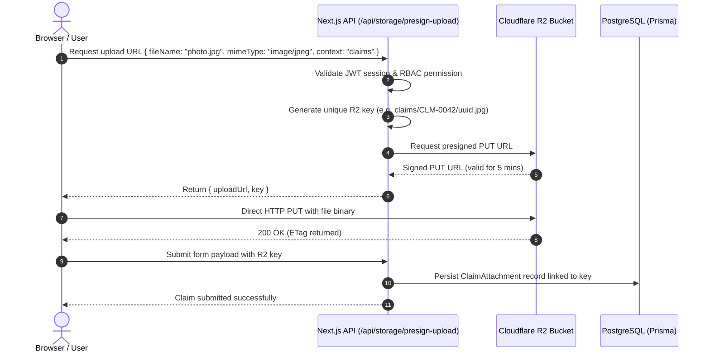

# Technical Architecture & Engineering Blueprint: Next.js + PostgreSQL + Prisma + Cloudflare R2

This document specifies the technical architecture, directory structure, data models, object storage integration, and unit testing strategy for building the enterprise B2B export portal.

---

## 1. Technology Stack Specification

| Layer | Technology | Version / Package | Rationale |
| :--- | :--- | :--- | :--- |
| **Framework** | Next.js | `15.x` (App Router) | React Server Components for fast data rendering, Server Actions for mutations, unified fullstack TypeScript. |
| **Language** | TypeScript | `5.x` | End-to-end type safety across database models, API payloads, and UI components. |
| **Database** | PostgreSQL | `16.x` | ACID compliance, transactional integrity for financial credit & shipment records, JSONB support for flexible metadata. |
| **ORM** | Prisma ORM | `5.x` / `6.x` | Declarative schema, automated migrations, type-safe queries, transaction support. |
| **Object Store** | Cloudflare R2 | S3 API (`@aws-sdk/client-s3`) | Zero egress fees, global edge distribution, S3-compatible presigned URL workflow for secure direct uploads. |
| **Presigned URLs** | AWS SDK v3 | `@aws-sdk/s3-request-presigner` | Offload heavy file transfers directly to R2 without blocking Next.js compute. |
| **Validation** | Zod | `3.x` | Runtime schema validation for all forms, Server Actions, and API inputs. |
| **Unit Testing** | Vitest + RTL | `vitest`, `@testing-library/react` | Blazing fast ESM execution, native TypeScript support, **strict 90% coverage threshold per file**. |
| **Mocking** | Vitest Mock Extended | `vitest-mock-extended` | Deep type-safe mocking of Prisma Client and AWS S3 Client. |
| **Authentication** | NextAuth / Auth.js | `v5` (Beta) / JWT Session | Stateless JWT sessions with active company context cookie and role claims. |
| **Styling** | Vanilla CSS / CSS Modules | Standard CSS3 with Design Tokens | Clean design system, high performance, CSS variables for theming without utility class lock-in. |

---

## 2. Project Directory Structure

```
allana/
├── .github/
│   └── workflows/
│       └── ci.yml               # Automated CI running tests & 90% coverage validation
├── prisma/
│   ├── schema.prisma            # Comprehensive Prisma database schema
│   ├── seed.ts                  # Database seeder with B2B mock data
│   └── migrations/              # Prisma SQL migration history
├── public/
│   └── brand/                   # Logos, static icons, favicon
├── scripts/
│   └── seed-r2.ts               # Object store seeding script (mock files to R2)
├── src/
│   ├── app/                     # Next.js App Router root
│   │   ├── (auth)/              # Route group for unauthenticated flows
│   │   │   ├── login/
│   │   │   ├── forgot-password/
│   │   │   └── reset-password/
│   │   ├── (portal)/            # Authenticated customer portal layout
│   │   │   ├── layout.tsx       # Main header, company switcher, bell, footer
│   │   │   ├── page.tsx         # Dashboard (/): KPIs, Recent Shipments, News, Licenses
│   │   │   ├── catalog/         # Product catalog with search, filters & PDP
│   │   │   │   ├── page.tsx
│   │   │   │   └── [slug]/page.tsx
│   │   │   ├── customized-products/ # NPD requests & creation wizard
│   │   │   │   ├── page.tsx
│   │   │   │   └── new/page.tsx
│   │   │   ├── shipments/       # Shipments list, container drilldown & documents
│   │   │   │   ├── page.tsx
│   │   │   │   └── [id]/page.tsx
│   │   │   ├── sales-plan/      # Sales plan forecasting grid
│   │   │   │   └── page.tsx
│   │   │   ├── reports/         # Financial reports generator
│   │   │   │   └── page.tsx
│   │   │   ├── claims/          # Claims and inquiries desk
│   │   │   │   ├── page.tsx
│   │   │   │   ├── new-claim/page.tsx
│   │   │   │   ├── new-request/page.tsx
│   │   │   │   └── [id]/page.tsx
│   │   │   ├── news/            # News and announcement feed
│   │   │   │   ├── page.tsx
│   │   │   │   └── [id]/page.tsx
│   │   │   └── settings/        # User and company settings
│   │   │       ├── profile/page.tsx
│   │   │       ├── members/page.tsx
│   │   │       ├── action-log/page.tsx
│   │   │       ├── licenses/page.tsx
│   │   │       └── change-password/page.tsx
│   │   └── api/                 # API Route Handlers
│   │       ├── auth/[...nextauth]/route.ts
│   │       ├── storage/
│   │       │   ├── presign-upload/route.ts
│   │       │   └── presign-download/route.ts
│   │       ├── reports/generate/route.ts
│   │       └── notifications/route.ts
│   ├── components/              # Modular UI components
│   │   ├── common/              # Header, CompanySwitcher, NotificationBell, BrandShowcase, Footer, LogoutModal
│   │   ├── dashboard/           # FinancialCards, SalesOrgSelector, RecentShipmentsWidget, HeroSlider, NewsGrid, LicenseAlertBanner
│   │   ├── catalog/             # CatalogLanding, CatalogSearch, FilterSidebar, SubcategoryPills, ProductGrid, ProductTable, PackagingSwitcher, ProductSpecTable, LoadingPatternCard
│   │   ├── custom-products/     # CustomProductForm, CustomProductTable, NpdTimeline
│   │   ├── shipments/           # ShipmentFilterBar, ShipmentRow, ContainerAccordion, CargoItemsTable, DocumentVault
│   │   ├── sales-plan/          # SalesPlanFilterBar, SalesPlanGrid, CountryGroupRow, ShipToGroupRow, SkuItemRow
│   │   ├── reports/             # StatementReportCard, ReceivablesReportCard
│   │   ├── claims/              # ClaimsTable, ClaimRowPreview, ClaimForm, ClaimProductLines, InfoRequestForm, CategoryTreeSelector, ClaimDetailView
│   │   ├── settings/            # AccountSubNav, LicenseCard, ActionLogTable
│   │   ├── members/             # AddMemberModal, EditMemberModal, DeleteMemberModal
│   │   ├── profile/             # ManagerContactCard, RelatedCompaniesTable
│   │   ├── news/                # NewsCard, NewsArticleView
│   │   └── notifications/       # NotificationDrawer, NotificationItemCard
│   ├── lib/                     # Infrastructure and shared libraries
│   │   ├── auth.ts              # Session config, RBAC verification helpers
│   │   ├── prisma.ts            # Prisma client singleton instance
│   │   ├── r2.ts                # Cloudflare R2 S3 client & presigning utilities
│   │   ├── email.ts             # Transactional email dispatcher
│   │   ├── pdf.ts               # Server-side PDF spec sheet / statement generator
│   │   └── utils.ts             # Currency, date, and math formatting helpers
│   ├── server/                  # Server Actions for mutations
│   │   ├── actions/
│   │   │   ├── auth.actions.ts
│   │   │   ├── members.actions.ts
│   │   │   ├── custom-product.actions.ts
│   │   │   ├── claims.actions.ts
│   │   │   └── reports.actions.ts
│   │   └── validators/          # Zod validation schemas
│   │       ├── member.schema.ts
│   │       ├── claim.schema.ts
│   │       └── custom-product.schema.ts
│   └── styles/                  # CSS Design System Tokens
│       ├── globals.css
│       ├── tokens.css           # Colors, typography, spacing, shadows
│       └── components/          # Scoped CSS modules
├── tests/                       # Unit tests targeting 90% per-file coverage
│   ├── lib/
│   │   ├── r2.test.ts
│   │   ├── auth.test.ts
│   │   └── utils.test.ts
│   ├── server/
│   │   ├── claims.actions.test.ts
│   │   ├── members.actions.test.ts
│   │   └── custom-product.actions.test.ts
│   ├── components/
│   │   ├── FinancialCards.test.tsx
│   │   ├── ProductCard.test.tsx
│   │   └── ShipmentRow.test.tsx
│   └── api/
│       └── presign.test.ts
├── vitest.config.ts             # Vitest test configuration with 90% per-file coverage
├── tsconfig.json
└── package.json
```

---

## 3. PostgreSQL & Prisma Schema Design

Here is the complete declarative schema covering all entities, relations, enums, and foreign keys:

```prisma
datasource db {
  provider = "postgresql"
  url      = env("DATABASE_URL")
}

generator client {
  provider = "prisma-client-js"
}

// -------------------------------------------------------------
// ENUMS
// -------------------------------------------------------------

enum UserRole {
  ADMIN
  BUYER
  PROCUREMENT
  FINANCE
  LOGISTICS
  QA
  MHP_MANAGER
}

enum Permission {
  VIEW_CATALOG
  ORDER_CUSTOM_PRODUCT
  VIEW_SHIPMENTS
  VIEW_FINANCIALS
  SUBMIT_CLAIMS
  MANAGE_MEMBERS
  VIEW_REPORTS
  DOWNLOAD_DOCUMENTS
  CLIENT_MANAGEMENT
  VIEW_CLIENTS
  VIEW_LOGS
}

enum CustomProductStatus {
  IN_REVIEW
  ANALYSIS
  ACCEPTED
  DECLINED
}

enum ShipmentStatus {
  BOOKED
  LOADED
  IN_TRANSIT
  ARRIVED_PORT
  CUSTOMS_CLEARED
  DELIVERED
}

enum ClaimStatus {
  REGISTERED
  UNDER_REVIEW
  INVESTIGATION
  CLARIFICATION_REQUIRED
  PARTLY_ACCEPTED
  ACCEPTED
  REJECTED
  COMPLETED
}

enum ClaimType {
  CLAIM
  INFO_REQUEST
}

enum InfoRequestCategory {
  QUESTIONNAIRE
  DOCS_SPECIFICATION
  DOCS_SURVEY_REPORT
  DOCS_CERTIFICATE
  DOCS_DECLARATION_QUALITY
  DOCS_DECLARATION_SHELF_LIFE
  DOCS_DECLARATION_LEGISLATION
  DOCS_DECLARATION_OTHER
  OTHER_QUALITY_SAFETY
  OTHER_AUDIT
  OTHER_CLARIFYING_INFO
}

enum FreezingType {
  BLOCK_FROZEN
  IQF
  BLAST_FROZEN
  CHILLED
}

enum UnitOfMeasure {
  TONNES
  USD
}

// -------------------------------------------------------------
// COMPANY & ORGANIZATIONAL HIERARCHY
// -------------------------------------------------------------

model Company {
  id               String            @id @default(uuid())
  name             String
  code             String            @unique
  region           String
  country          String
  telephone        String
  email            String
  createdAt        DateTime          @default(now())
  updatedAt        DateTime          @updatedAt

  // Multi-Company Hierarchy (Parent / Subsidiary)
  parentCompanyId  String?
  parentCompany    Company?          @relation("RelatedCompanies", fields: [parentCompanyId], references: [id], onDelete: Cascade)
  subsidiaries     Company[]         @relation("RelatedCompanies")

  // Assigned Account Manager
  managerName      String?
  managerEmail     String?
  managerPhone     String?

  // Relations
  users            User[]
  financials       CompanyFinancial[]
  shipments        Shipment[]
  customProducts   CustomProductRequest[]
  claims           Claim[]
  salesPlans       SalesPlan[]
  actionLogs       ActionLog[]
  licenses         ComplianceLicense[]

  @@index([parentCompanyId])
  @@index([country])
}

model SalesOrganization {
  id          String             @id @default(uuid())
  code        String             @unique
  name        String
  description String?
  currency    String             @default("USD")
  financials  CompanyFinancial[]
  shipments   Shipment[]
  salesPlans  SalesPlan[]
}

model CompanyFinancial {
  id                   String            @id @default(uuid())
  companyId            String
  company              Company           @relation(fields: [companyId], references: [id], onDelete: Cascade)
  salesOrgId           String
  salesOrganization    SalesOrganization @relation(fields: [salesOrgId], references: [id], onDelete: Cascade)
  
  creditLimit          Decimal           @db.Decimal(12, 2)
  receivables          Decimal           @db.Decimal(12, 2)
  overdueReceivables   Decimal           @db.Decimal(12, 2)
  availableLimit       Decimal           @db.Decimal(12, 2)
  updatedAt            DateTime          @updatedAt

  @@unique([companyId, salesOrgId])
}

// -------------------------------------------------------------
// USER, RBAC & AUDIT LOGS
// -------------------------------------------------------------

model User {
  id               String       @id @default(uuid())
  email            String       @unique
  passwordHash     String
  firstName        String
  lastName         String?
  patronymic       String?
  phone            String?
  comment          String?      @db.Text
  jobTitle         String?      // E.g. "QA Manager", "Procurement Lead"
  role             UserRole     @default(BUYER)
  permissions      Permission[]
  isFirstLogin     Boolean      @default(true)
  twoFactorEnabled Boolean      @default(false)
  twoFactorSecret  String?
  resetToken       String?
  resetTokenExpiry DateTime?
  isActive         Boolean      @default(true)
  createdAt        DateTime     @default(now())
  updatedAt        DateTime     @updatedAt

  companyId        String
  company          Company      @relation(fields: [companyId], references: [id], onDelete: Cascade)

  // Audit and Submissions
  authoredLogs     ActionLog[]  @relation("LogAuthor")
  customRequests   CustomProductRequest[]
  claimsSubmitted  Claim[]
  notifications    Notification[]

  @@index([companyId])
  @@index([email])
}

model ActionLog {
  id          String   @id @default(uuid())
  companyId   String
  company     Company  @relation(fields: [companyId], references: [id], onDelete: Cascade)
  authorId    String
  author      User     @relation("LogAuthor", fields: [authorId], references: [id], onDelete: Cascade)
  action      String   // E.g. "USER_CREATED", "PERMISSIONS_UPDATED"
  comment     String
  createdAt   DateTime @default(now())

  @@index([companyId])
  @@index([authorId])
}

// -------------------------------------------------------------
// PRODUCT CATALOG
// -------------------------------------------------------------

model Category {
  id            String        @id @default(uuid())
  name          String        @unique
  slug          String        @unique
  description   String?
  subcategories Subcategory[]
  products      Product[]
}

model Subcategory {
  id          String    @id @default(uuid())
  name        String
  slug        String
  categoryId  String
  category    Category  @relation(fields: [categoryId], references: [id], onDelete: Cascade)
  products    Product[]

  @@unique([categoryId, slug])
}

model Product {
  id                  String             @id @default(uuid())
  sku                 String             @unique
  name                String
  slug                String             @unique
  brand               String             // E.g. "Allana", "Al-Tamam"
  categoryId          String
  category            Category           @relation(fields: [categoryId], references: [id])
  subcategoryId       String?
  subcategory         Subcategory?       @relation(fields: [subcategoryId], references: [id])
  
  productState        String             // Frozen, Chilled, IQF
  primaryPackaging    String             // Vacuum Pack (IWP), Polywrapped Bulk
  storageTemperature String             @default("-18°C")
  shelfLifeMonths     Int                @default(24)
  
  // Dimensions and Loading Parameters
  cartonNetWeightKg   Decimal            @db.Decimal(8, 2)
  cutSize             String?            // e.g. "55-75 g", "Uncalibrated", "36-64g"
  packagesPerCarton   Int?               // e.g. 6, 12, 4
  cartonWeightKg      Decimal?           @db.Decimal(8, 2) // Gross carton weight e.g. 12.00
  cartonDimensionsMm  String             // e.g. "580 x 380 x 140"
  cartonsPerPallet    Int
  palletsPerContainer Int                @default(20)
  totalContainerWeightMt Decimal         @db.Decimal(8, 2)
  freezingType        String?            // e.g. "BF", "IQF", "BQF"

  // Media & Certifications stored in R2
  imageUrl            String?
  packagingImageUrl   String?
  specSheetPdfUrl     String?
  certifications      String[]           // "HALAL", "ISO_22000", "HACCP", "SFDA"
  description         String             @db.Text
  isUnderDevelopment  Boolean            @default(false)
  createdAt           DateTime           @default(now())
  updatedAt           DateTime           @updatedAt

  shipmentItems       ShipmentItem[]
  claimItems          ClaimProductItem[]

  @@index([categoryId])
  @@index([subcategoryId])
  @@index([brand])
}

// -------------------------------------------------------------
// CUSTOMIZED PRODUCT REQUEST (NPD)
// -------------------------------------------------------------

model CustomProductRequest {
  id              String              @id @default(uuid())
  requestNumber   String              @unique
  companyId       String
  company         Company             @relation(fields: [companyId], references: [id], onDelete: Cascade)
  createdById     String
  createdBy       User                @relation(fields: [createdById], references: [id], onDelete: Cascade)

  categoryName    String
  targetCountry   String
  cutSpecification String             @db.Text
  recipeNotes     String?             @db.Text
  packagingFormat String              // e.g. "450g vacuum pack retail cube"
  targetVolumeMt  Decimal?            @db.Decimal(10, 2)
  targetPriceUsd  Decimal?            @db.Decimal(10, 2)
  attachmentUrl   String?             // R2 link
  status          CustomProductStatus @default(IN_REVIEW)
  managerComments String?             @db.Text
  createdAt       DateTime            @default(now())
  updatedAt       DateTime            @updatedAt

  @@index([companyId])
  @@index([createdById])
  @@index([status])
}

// -------------------------------------------------------------
// SHIPMENTS & LOGISTICS
// -------------------------------------------------------------

model Shipment {
  id               String            @id @default(uuid())
  orderNumber      String            @unique
  companyId        String
  company          Company           @relation(fields: [companyId], references: [id], onDelete: Cascade)
  salesOrgId       String
  salesOrganization SalesOrganization @relation(fields: [salesOrgId], references: [id])
  
  shipToParty      String
  destinationCountry String
  totalQuantityMt  Decimal           @db.Decimal(10, 2)
  totalAmountUsd   Decimal           @db.Decimal(12, 2)
  status           ShipmentStatus    @default(BOOKED)

  // Voyage & Logistics
  shippingLine     String            // Maersk, MSC, CMA CGM
  vesselName       String?
  voyageNumber     String?
  portOfLoading    String            @default("JNPT Nhava Sheva, India")
  portOfDestination String
  shippingDate     DateTime?
  etd              DateTime
  eta              DateTime

  containers       Container[]
  documents        ShipmentDocument[]
  claims           Claim[]
  createdAt        DateTime          @default(now())
  updatedAt        DateTime          @updatedAt

  @@index([companyId])
  @@index([destinationCountry])
  @@index([status])
}

model Container {
  id              String         @id @default(uuid())
  shipmentId      String
  shipment        Shipment       @relation(fields: [shipmentId], references: [id], onDelete: Cascade)
  containerNumber String         // e.g. "MSKU9482710"
  sealNumber      String?
  reeferSetTemp   String         @default("-18.0°C")
  items           ShipmentItem[]

  @@index([shipmentId])
}

model ShipmentItem {
  id          String    @id @default(uuid())
  containerId String
  container   Container @relation(fields: [containerId], references: [id], onDelete: Cascade)
  productId   String
  product     Product   @relation(fields: [productId], references: [id])
  quantityMt  Decimal   @db.Decimal(10, 2)
  amountUsd   Decimal   @db.Decimal(12, 2)

  @@index([containerId])
  @@index([productId])
}

model ShipmentDocument {
  id          String   @id @default(uuid())
  shipmentId  String
  shipment    Shipment @relation(fields: [shipmentId], references: [id], onDelete: Cascade)
  documentType String   // "BILL_OF_LADING", "VET_CERT", "HALAL_CERT", "INVOICE", "PACKING_LIST"
  fileName    String
  fileUrl     String   // Cloudflare R2 Key / URL
  fileSizeBytes Int
  createdAt   DateTime @default(now())

  @@index([shipmentId])
}

// -------------------------------------------------------------
// SALES PLAN & FORECASTING
// -------------------------------------------------------------

model SalesPlan {
  id               String            @id @default(uuid())
  companyId        String
  company          Company           @relation(fields: [companyId], references: [id], onDelete: Cascade)
  salesOrgId       String
  salesOrganization SalesOrganization @relation(fields: [salesOrgId], references: [id])
  
  month            Int               // 1-12
  year             Int               // e.g. 2026
  country          String
  shipToParty      String
  sku              String
  skuName          String
  
  targetTonnes     Decimal           @db.Decimal(10, 2)
  targetUsd        Decimal           @db.Decimal(12, 2)
  lastMonthBalance Decimal           @db.Decimal(10, 2)
  shippedTonnes    Decimal           @db.Decimal(10, 2)
  shippedUsd       Decimal           @db.Decimal(12, 2)
  pipelineTonnes   Decimal           @db.Decimal(10, 2)
  pipelineUsd      Decimal           @db.Decimal(12, 2)
  
  updatedAt        DateTime          @updatedAt

  @@unique([companyId, salesOrgId, month, year, shipToParty, sku])
  @@index([companyId, month, year])
}

// -------------------------------------------------------------
// CLAIMS & SERVICE DESK
// -------------------------------------------------------------

model Claim {
  id                           String               @id @default(uuid())
  claimNumber                  String               @unique // e.g. "CLM-2026-0042" or "REQ-2026-001"
  companyId                    String
  company                      Company              @relation(fields: [companyId], references: [id], onDelete: Cascade)
  submittedById                String
  submittedBy                  User                 @relation(fields: [submittedById], references: [id], onDelete: Cascade)
  
  type                         ClaimType            @default(CLAIM)
  status                       ClaimStatus          @default(REGISTERED)
  subject                      String
  categoryOfRequest            String?              // e.g. "Underload", "Quality Defect", "Shortage"
  supplierName                 String?              // Supplier / Processing plant selected
  
  // Info Request Specific Fields
  infoCategory                 InfoRequestCategory?
  targetCountry                String?
  requestedShelfLifeDate       DateTime?
  reasonForShelfLifeExtension  String?              @db.Text
  shelfLifeExtensionVolumeKg   Decimal?             @db.Decimal(12, 4)

  // Shipment / Order References
  shipmentId                   String?
  shipment                     Shipment?            @relation(fields: [shipmentId], references: [id], onDelete: SetNull)
  containerNumber              String?
  invoiceNumber                String?
  deliveryDate                 DateTime?

  description                  String?              @db.Text
  additionalEmails             String?              // Semicolon-separated list of additional recipient emails
  companyResponse              String?              @db.Text
  resolvedAt                   DateTime?
  
  products                     ClaimProductItem[]
  attachments                  ClaimAttachment[]
  createdAt                    DateTime             @default(now())
  updatedAt                    DateTime             @updatedAt

  @@index([companyId])
  @@index([status])
}

model ClaimProductItem {
  id                   String    @id @default(uuid())
  claimId              String
  claim                Claim     @relation(fields: [claimId], references: [id], onDelete: Cascade)
  productId            String?
  product              Product?  @relation(fields: [productId], references: [id])
  productArticle       String    // e.g. "8320L" (check in invoice)
  productName          String    // Auto-filled after entering article
  producerName         String?   // "The Product Producer"
  country              String?
  productionDate       DateTime?
  lotNumber            String?
  vehicleNumber        String?   // Max 100 chars
  nonConformWeightKg   Decimal   @db.Decimal(12, 4) // Format 00.0000
  receivedQuantityKg   Decimal?  @db.Decimal(12, 4) // Format 00.0000

  @@index([claimId])
}

model ClaimAttachment {
  id            String   @id @default(uuid())
  claimId       String
  claim         Claim    @relation(fields: [claimId], references: [id], onDelete: Cascade)
  fileName      String
  fileUrl       String   // Cloudflare R2 Key
  fileSizeBytes Int
  createdAt     DateTime @default(now())

  @@index([claimId])
}

// -------------------------------------------------------------
// COMPLIANCE LICENSES, NEWS & NOTIFICATIONS
// -------------------------------------------------------------

model ComplianceLicense {
  id             String    @id @default(uuid())
  companyId      String
  company        Company   @relation(fields: [companyId], references: [id], onDelete: Cascade)
  country        String    // e.g. "Saudi Arabia", "UAE"
  licenseName    String    // e.g. "SFDA Meat Import Facility License"
  licenseNumber  String
  issueDate      DateTime
  expiryDate     DateTime
  documentUrl    String?   // R2 Key
  createdAt      DateTime  @default(now())

  @@index([companyId, expiryDate])
}

model NewsArticle {
  id          String   @id @default(uuid())
  title       String
  slug        String   @unique
  summary     String
  contentHtml String   @db.Text
  imageUrl    String?
  isSlider    Boolean  @default(false)
  publishedAt DateTime @default(now())
}

model Notification {
  id          String   @id @default(uuid())
  userId      String
  user        User     @relation(fields: [userId], references: [id], onDelete: Cascade)
  title       String
  message     String
  link        String?
  isRead      Boolean  @default(false)
  createdAt   DateTime @default(now())

  @@index([userId, isRead])
}
```

---

## 4. Cloudflare R2 Object Storage Architecture

Cloudflare R2 provides an S3-compatible API with zero egress fees. The application interacts with R2 via `@aws-sdk/client-s3` and `@aws-sdk/s3-request-presigner`.

### 4.1 Bucket Layout & Key Conventions

```
r2://allana-customer-portal/
├── products/
│   ├── images/{sku}-sample.webp
│   ├── packaging/{sku}-carton.webp
│   └── specs/{sku}-technical-specification.pdf
├── shipments/
│   └── {orderNumber}/
│       ├── bill-of-lading-{blNumber}.pdf
│       ├── vet-certificate-{certId}.pdf
│       ├── halal-certificate.pdf
│       └── commercial-invoice.pdf
├── claims/
│   └── {claimNumber}/
│       ├── damaged-packaging-{uuid}.jpg
│       ├── temp-logger-graph-{uuid}.pdf
│       └── survey-report.pdf
├── licenses/
│   └── {companyCode}/{licenseNumber}.pdf
└── reports/
    └── generated/{companyCode}/statement-{timestamp}.pdf
```

### 4.2 S3 Client Initialization (`src/lib/r2.ts`)

```typescript
import { S3Client, PutObjectCommand, GetObjectCommand } from '@aws-sdk/client-s3';
import { getSignedUrl } from '@aws-sdk/s3-request-presigner';

const R2_ACCOUNT_ID = process.env.R2_ACCOUNT_ID;
const R2_ACCESS_KEY_ID = process.env.R2_ACCESS_KEY_ID;
const R2_SECRET_ACCESS_KEY = process.env.R2_SECRET_ACCESS_KEY;
const R2_BUCKET_NAME = process.env.R2_BUCKET_NAME || 'allana-export-portal';

export const r2Client = new S3Client({
  region: 'auto',
  endpoint: `https://${R2_ACCOUNT_ID}.r2.cloudflarestorage.com`,
  credentials: {
    accessKeyId: R2_ACCESS_KEY_ID || '',
    secretAccessKey: R2_SECRET_ACCESS_KEY || '',
  },
});

/**
 * Generate a time-limited Presigned URL for direct browser-to-R2 upload
 */
export async function createPresignedUploadUrl(
  key: string,
  contentType: string,
  expiresInSeconds = 300
): Promise<{ uploadUrl: string; key: string }> {
  const command = new PutObjectCommand({
    Bucket: R2_BUCKET_NAME,
    Key: key,
    ContentType: contentType,
  });

  const uploadUrl = await getSignedUrl(r2Client, command, { expiresIn: expiresInSeconds });
  return { uploadUrl, key };
}

/**
 * Generate a secure time-limited Presigned URL for private file download
 */
export async function createPresignedDownloadUrl(
  key: string,
  expiresInSeconds = 900
): Promise<string> {
  const command = new GetObjectCommand({
    Bucket: R2_BUCKET_NAME,
    Key: key,
  });

  return getSignedUrl(r2Client, command, { expiresIn: expiresInSeconds });
}
```

### 4.3 Direct Upload Workflow



---

## 5. Unit Testing Architecture & 90% Coverage Enforcement

### 5.1 Test Framework Configuration (`vitest.config.ts`)

```typescript
import { defineConfig } from 'vitest/config';
import react from '@vitejs/plugin-react';
import path from 'path';

export default defineConfig({
  plugins: [react()],
  test: {
    environment: 'jsdom',
    globals: true,
    setupFiles: ['./tests/setup.ts'],
    alias: {
      '@': path.resolve(__dirname, './src'),
    },
    coverage: {
      provider: 'v8',
      reporter: ['text', 'json', 'html', 'lcov'],
      // CRITICAL REQUIREMENT: 90% per each file
      thresholds: {
        lines: 90,
        functions: 90,
        branches: 90,
        statements: 90,
        perFile: true,
      },
      exclude: [
        'node_modules/**',
        'dist/**',
        'prisma/**',
        'scripts/**',
        '**/*.d.ts',
        'tests/**',
        'src/types/**',
      ],
    },
  },
});
```

### 5.2 Deep Mocking Patterns for Prisma & AWS S3 (`tests/setup.ts`)

```typescript
import { vi } from 'vitest';
import { mockDeep, mockReset, DeepMockProxy } from 'vitest-mock-extended';
import { PrismaClient } from '@prisma/client';
import { prisma } from '@/lib/prisma';

vi.mock('@/lib/prisma', () => ({
  __esModule: true,
  prisma: mockDeep<PrismaClient>(),
}));

export const prismaMock = prisma as unknown as DeepMockProxy<PrismaClient>;

beforeEach(() => {
  mockReset(prismaMock);
});
```
