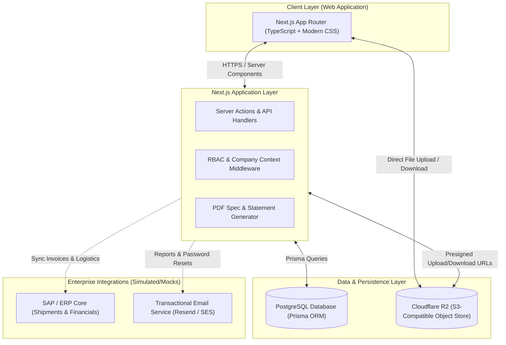

# Product Requirements Analysis & Synthesis: B2B Export Portal (Allana Platform)

Based on the assessment and user manual documents:
1. **`docs/MHP Portal Assessment.pdf`** (B2B Export Customer Portal Strategy & Industry Benchmark)
2. **`docs/user_manual.pdf`** (36-Page MHP Export Client Portal User Manual & Specification)

---

## 1. Executive Summary & Product Positioning

### 1.1 What This Software Is (and Is Not)
- **NOT a B2C E-Commerce Storefront**: This is not an open shopping cart with instant credit card checkout.
- **IS an Enterprise B2B Customer Self-Service Ecosystem**: It operates as a bridge between **ERP (SAP), CRM, Shipment Logistics, Quality Control, and Financial Accounting**, empowering international meat importers, distributors, retail chains (e.g., LuLu, Carrefour, Panda), and food processors to manage their end-to-end export relationship autonomously.

### 1.2 Core Business Value for Allana (Meat & Agro-Export Business)
- **Elimination of Routine Inquiries**: Drastically reduces repetitive emails and WhatsApp calls regarding container status ("Has vessel sailed?", "Send ETA", "Send Bill of Lading and Halal Cert").
- **Digital Sales Brochure & SKU Discovery**: Solves high SKU complexity for Buffalo cuts (Silverside, Topside, Tenderloin, Striploin, Shin Shank, Chuck Tender, Trimmings, Offals, VPCM) and Sheep/Goat cuts with exact specifications, freezing parameters, carton dimensions, pallet configurations, and certifications.
- **Streamlined Custom Product Development (NPD)**: Digitizes customer requests for specialized cuts, vacuum-packed retail portions (e.g., 450g chilled goat cubes), private-label packaging, and recipes across the **Customer → Sales → R&D → Production → Customer** approval lifecycle.
- **Financial & Working Capital Transparency**: Displays real-time credit limits, utilized credit, outstanding receivables, and overdue invoices, giving procurement managers instant clarity on purchasing capacity.
- **Structured Claims & Service Desk**: Replaces disorganized email complaints with an auditable claim ticketing system supporting multi-product lines, weight/batch details, and mandatory photo/temperature logger attachments.

---

## 2. User Personas & Role-Based Access Control (RBAC) Matrix

A single customer account (e.g., "LuLu International Group") accommodates multiple users across different corporate functions, each granted specific modular permissions:

| Persona | Primary Needs & Modules Accessed | Actions & Permissions |
| :--- | :--- | :--- |
| **Buyer / Category Manager** | Product Catalog, Customized Products (NPD), Sales Plan | Browse cuts/SKUs, download spec sheets, submit custom product requests, review monthly sales targets. |
| **Procurement Manager** | Shipments List, Sales Plan, Order Tracking | Track container movements, monitor order pipeline against allocations, review supplier delivery performance. |
| **Finance Team / Controller** | Financial Dashboard, Reports, Invoices | View credit limits, outstanding & overdue receivables, request Account Statements & Aging Reports via email. |
| **Logistics / Import Team** | Shipments List, Document Vault, Notifications | Track ETD/ETA, reefer container numbers, vessel names, download Bills of Lading, Health/Vet Certificates, Packing Lists. |
| **QA / Quality Assurance** | Catalog Technical Specs, Claims & Requests, Licenses | Review storage temps, shelf life, microbiological specs, inspect halal/SFDA certs, submit quality/damage claims with evidence. |
| **Company Administrator** | Members List, Profile, Action Log, Permissions | Invite internal team members, grant/revoke module access, review security action logs, switch related subsidiaries. |
| **Allana Internal Manager (Admin)**| CRM Back-Office, Claims Review, Custom Product Approvals | Update shipment status, upload BL/Certs, review custom product requests (In Review → Analysis → Accepted/Declined), process claims. |

---

## 3. High-Level System Architecture & Flow

---

## 4. Comprehensive Functional Modules Breakdown

### 4.0 Exhaustive 17-Section Traceability & Verification Matrix (Mapping to User Manual & Assessment)

Every single section and subsection from the 36-page `user_manual.pdf` and 5-page `MHP Portal Assessment.pdf` maps directly to our modular fullstack architecture:

| User Manual Section | UI Elements & Screenshots Audited | Corresponding Module & Feature ID | System Implementation Details |
| :--- | :--- | :--- | :--- |
| **1. Authorization** (p. 2) | First-time welcome email, temporary password, mandatory redirect to password change, restore password link with email reset token | **Module 1**: `FEAT-1.1` | NextAuth credentials provider, `isFirstLogin` guard in middleware, `/settings/change-password` redirection, and email reset tokens. |
| **2. Header Menu** (p. 2–3) | Top navigation bar: Dashboard, Products Catalog, Customized Product, Shipments List, Sales Plan, Reports, News, Claims and Requests; Allana logo returns to Dashboard | **Module 2**: `FEAT-2.1` | App Router persistent layout in `src/app/(portal)/layout.tsx`, active route indicator bar, responsive desktop/tablet/mobile navigation. |
| **3. Header** (p. 3–4) | **3.1 Related Companies dropdown**: Left flyout with `Counterpart:` search input and subsidiary switcher. **3.2 Notifications (Bell)**: Live unread badge, popover with `Show only unread` toggle, individual mark-read checkboxes, `Check all` master checkbox, deep links (`Claim Request`, `Shipments`, `Licenses`), arrival alerts at 14d & vessel docking. **3.3 Settings gear menu**: Profile, Members List, Licenses (SFDA), Action Log, Password, Logout. | **Module 1**: `FEAT-1.2` **Module 9**: `FEAT-9.1` **Module 1**: `FEAT-1.3` to `FEAT-1.7` | `CompanySwitcher.tsx` with secure cookie, `NotificationDrawer.tsx` with server actions, and accessible user settings dropdown menu. |
| **4. Profile** (p. 4–6) | **4.1 Company Info**: Name, Region, Country, Telephone, E-mail. **4.2 Contact Info**: Allana Export Manager name, photo, direct phone, email. **4.3 Related Companies**: Table (COMPANY, COUNTRY, MANAGER, E-MAIL), row expander (`>`) showing address/region/phone, and green `Sign in` switch button. | **Module 1**: `FEAT-1.3` | `/settings/profile` page with `ManagerContactCard.tsx` and `RelatedCompaniesTable.tsx`. |
| **5. Members List** (p. 7–8) | **Roster Table**: EMAIL, PHONE, FIRST NAME, CREATED DATE, EDIT, REMOVE. **Add User Form**: Name, Surname, Patronymic, Email, Phone, Comment (textarea), Settings (`Active`, `Two-factor authorization`), Granular Permissions (`Client Management`, `View clients`, `View logs`, Catalog, Shipments, Claims, Financials, Reports, Documents). | **Module 1**: `FEAT-1.4` | `/settings/members` with `AddMemberModal.tsx`, `EditMemberModal.tsx`, `DeleteMemberModal.tsx`, and RBAC permission checks in Server Actions. |
| **6. Action Log** (p. 9) | Audit trail table: DATE (`13 May 2022 15:05`), AUTHOR, COMMENT description of administrative operations. | **Module 1**: `FEAT-1.5` | `/settings/action-log` backed by Prisma `ActionLog` model, scoped strictly to active company. |
| **7. Password Change** (p. 9) | Modal dialog: Current password, New password, Confirm new password. | **Module 1**: `FEAT-1.1` | Accessible password update modal dialog updating bcrypt hash and logging audit event. |
| **8. Exit / Logout** (p. 10) | Confirmation modal: "Exit from the personal cabinet?" with `Yes` and `No` action buttons. | **Module 1**: `FEAT-1.6` | `LogoutModal.tsx` invalidating JWT session, clearing cookies, and redirecting to `/login`. |
| **9. Footer** (p. 11) | **Brand Showcase Strip**: Persistent row of company export brands (`Allana`, `Al-Tamam`, `OMAR`, `Premium Gold`). **Footer Links**: Copyright notice, Twitter/X, Facebook, LinkedIn, `General terms and conditions`, `Manual` (download User Manual PDF from R2), `Help & Support`. | **Module 2**: `FEAT-2.1` | `BrandShowcase.tsx` and `Footer.tsx` in global portal shell. |
| **10. Dashboard** (p. 11–14) | **10.1 Financials**: Credit Limit, Receivables, Overdue Receivables, Available Limit (with negative deficit styling), Multi-Sales Org selector. **10.2 Recent Shipments**: Last 3 months, Order ID, Shipments count, Quantity KG, Amount USD, Status badge, `Details` drilldown, `All Shipments >` link. **10.3 News & Slider**: Hero announcement carousel, 4-card news grid with `All News >` link. **10.4 Licenses Banner**: Dynamic alert bar under slider for Shipments ("Dear Partner, We have some shipments updates...") and License Expiry ("Your licence document will expire in 2 weeks...") with `See my licenses` link. | **Module 2**: `FEAT-2.2` `FEAT-2.3` `FEAT-2.4` `FEAT-2.5` **Module 1**: `FEAT-1.7` | Executive dashboard (`/`) integrating financial cards, recent shipments widget, hero carousel, news grid, and contextual warning banner. |
| **11. Products Catalog** (p. 15–19) | **Landing Page**: 4 hero category blocks (`Further processing product`, `Frozen buffalo meat products`, `New products`, `Customized products`), brand portfolio logos bar, "This part is under development" notice. **Search**: Live autocomplete with search character bolding, packaging specs, brand TM, and `Article: XXXX`. **Filters**: Collapsible sidebar, subcategory pills with **anatomical cut diagram icons**, removable filter tags (`[X]`), `Clear All` button. **View & Pagination**: Tile vs List toggle, 12/24/All dropdown, `Load More Products` button and `< 1 2 >` controls. **PDP**: Clickable breadcrumbs, interactive `Packaging` switcher row (`Vacuum block`, `Carton`, `Polybag`, `Tray`), 10-column logistics spec table, pallet loading calculator, certification badges, PDF spec exporter. | **Module 3**: `FEAT-3.1` `FEAT-3.2` `FEAT-3.3` `FEAT-3.4` `FEAT-3.5` | `/catalog` and `/catalog/[slug]` routes with `CatalogLanding.tsx`, `FilterSidebar.tsx`, `ProductGrid.tsx`, `PackagingSwitcher.tsx`, `ProductSpecTable.tsx`, and `pdf.ts`. |
| **12. Customized Product** (p. 20) | **Request Form**: `Create Order` button, category dropdown, freezing type (Block frozen, IQF, Blast frozen, Chilled), FCA price $/ton, individual packaging weight, meat processing checkboxes (`Calibrated`, `Marinated`, `Boneless`, `Skinless`, `Has Specification`), comments, 20MB R2 file upload. **Recent Orders Table**: Ticket ID (with Details link), Brief description, Created at, Status badge. **Status Timeline**: `In Review` → `Analysis` → `Accepted` / `Declined`. | **Module 4**: `FEAT-4.1` `FEAT-4.2` | `/customized-products` and `/customized-products/new` with `CustomProductForm.tsx`, `NpdTimeline.tsx`, and `CustomProductTable.tsx`. |
| **13. Shipments List** (p. 21–24) | **Filter Bar**: Period date range calendar, Sales Org, Country (`All`), Ship-To Party (`All`), `Get list` button, `Found X records` counter, multi-column sorter with direction toggle icon. **Table**: Order ID, `Details` / `Hide Details` link, Shipments count, Quantity KG, Amount USD, Status badge. **Level 1 Container Drilldown**: `Container No` with **green GPS pin icon**, Sea Line, Port of destination, Shipping Date, ETD, ETA, container weight/amount. **Level 2 Cargo Drilldown**: `v X SKU` button, cut photo, cut title, line weight KG, line amount USD. **Document Vault**: Presigned R2 download of B/L, Vet Cert, Halal, COO, CIPL. | **Module 5**: `FEAT-5.1` `FEAT-5.2` `FEAT-5.3` | `/shipments` page with `ShipmentFilterBar.tsx`, `ShipmentRow.tsx`, `ContainerAccordion.tsx`, `CargoItemsTable.tsx`, and `DocumentVault.tsx`. |
| **14. Sales Plan** (p. 25–28) | **Filter Bar**: Month/Year picker, Sales Org, Country, Ship-To Party, UOM (`Tonnes` vs `USD`), `Get list` button, `Found X records` counter, `Sort by: Country A-Z` with direction icon. **Table Columns**: `COUNTRY`, `SKU` (`Details` / `Hide Details`), `TARGET`, `LAST MONTH TRANSFER`, `SHIPPED`, `ORDER IN THE PIPELINE`, `DELTA BETWEEN TARGET AND SHIPPED`. **3-Tier Hierarchy**: Country level → Ship-To Party level with `v X SKU` button → SKU lines (`Code`, `Name`, Target, Transfer, Shipped, Pipeline, Delta). **Formula**: `Delta = (Shipped + Pipeline) - Target` (green surplus / red deficit). | **Module 6**: `FEAT-6.1` `FEAT-6.2` `FEAT-6.3` | `/sales-plan` page with `SalesPlanFilterBar.tsx`, `SalesPlanGrid.tsx`, `CountryGroupRow.tsx`, `ShipToGroupRow.tsx`, `SkuItemRow.tsx`, and `sales-plan-calc.ts`. |
| **15. Reports** (p. 28–29) | **15.1 Statement of Account**: Period calendar date range, `Additional e-mail` field, explanatory notice, `Send to e-mail` button, direct PDF/Excel download. **15.2 Receivables Aging**: As-of Date picker, `Additional e-mail` field, aging brackets (Current, 1–30, 31–60, 61–90, >90 Days), `Send to e-mail` button, direct download. | **Module 7**: `FEAT-7.1` `FEAT-7.2` | `/reports` page with `StatementReportCard.tsx`, `ReceivablesReportCard.tsx`, `aging-calc.ts`, and `email.ts`. |
| **16. News** (p. 29–30) | Latest 4 news cards on dashboard, full `/news` article feed, `/news/[slug]` rich article reader with hero image, metadata, and `Back to News` return button. | **Module 9**: `FEAT-9.2` **Module 2**: `FEAT-2.4` | `/news` and `/news/[slug]` with `NewsCard.tsx` and `NewsArticleView.tsx`. |
| **17. Claims and Requests** (p. 30–36) | **Top Actions**: `Claim Form` and `Info Request` green pill buttons. **Search & Filter**: Search by ticket ID or subject or article, Period date picker, Sort By (Ticket ID, Created Date), Show (12, 24, All). **Table**: `>` expand arrow, `CREATED ON`, `TICKET ID` (with Details link), `REQUEST TYPE`, `SUBJECT`, `STATUS` badge. **In-Place Row Preview**: Category of request, `Answer` (highlighted light green panel), Claim status, embedded line items table (`Product name`, `Product article`, `Production date`, `Supplier`, `Vehicle Number`). **Quality Claim Form**: Personal Data (email locked, job title), General Info (Subject *, Category, Supplier *), Product Description (pink banner "Please create one request...", Invoice Number *, Country *, Product Article * auto-populating Product Name *, Production Date * `dd-mm-yyyy`, Producer *, Lot Number, Vehicle Number * max 100 chars, Non-Conform weight * `00.0000 kg`, Received weight kg `00.00`, `Add Product +` up to 10 lines), Complaint Details (Description * up to 1000 chars, `Attach` button up to 20MB directly to R2, pink banners on photos/labels, `Additional contact` semicolon-separated emails, `Send` button). **Info Request Form**: Dynamic left category tree with 3 branches: • `Questionnaire` (pink banner, manufacturer *, factory article * max 40 chars, Product Name *, Add Product +, Attach, Send) • `Provision Of Documents` → `Specification` (pink banner, article * max 40 chars, Product Name *, Add Product +, Send) & `Declaration` → `Expiration Of Shelf Life` (pink banner, extended date * `dd-mm-yyyy`, production date `dd-mm-yyyy`, volume kg * `00.00`, manufacturer *, reasons textarea, Add Product +, Send) • `Other requests` (Product Quality & Safety, Audit, Clarifying Info). **Detail Page**: Full immutable audit record, presigned R2 downloads, official manager resolution notes. | **Module 8**: `FEAT-8.1` `FEAT-8.2` `FEAT-8.3` `FEAT-8.4` | `/claims`, `/claims/new-claim`, `/claims/new-request`, `/claims/[id]` with `ClaimsTable.tsx`, `ClaimRowPreview.tsx`, `ClaimForm.tsx`, `ClaimProductLines.tsx`, `InfoRequestForm.tsx`, `CategoryTreeSelector.tsx`, and `ClaimDetailView.tsx`. |

---

### Module 1: Authentication, Onboarding & Account Management
1. **Welcome Email & Temporary Credential Flow**: Customer company admin or user receives an activation email with system-generated credentials.
2. **Mandatory First-Time Password Reset**: First login redirects directly to `/settings/change-password`. User must set a strong password and re-authenticate before accessing the portal.
3. **Two-Factor Authentication (2FA)**: Support for optional two-factor authorization checkbox per user (`Two-factor authorization` in user settings), enforcing TOTP / SMS / email verification code upon login.
4. **Forgot / Reset Password Workflow**: Email-based secure reset token with expiration (1 hour), labeled `Restore password` with show/hide password toggle.
5. **Team Member Management**:
   - Fields: Name, Surname, Patronymic (middle/patronymic name), Email, Phone, Comment, Job Title.
   - Settings: `Active` toggle, `Two-factor authorization` toggle.
   - Permissions: Granular flags including `Client Management`, `View clients`, `View logs`, `View Catalog`, `Order Custom Product`, `View Shipments`, `View Financials`, `Submit Claims`, `View Reports`, `Download Documents`.
   - Actions: `Edit` and `Remove` with confirmation modal and audit logging.
6. **Company Context Switching with Counterpart Search**: For large conglomerates with multiple holding entities or country subsidiaries (e.g., LuLu UAE, LuLu KSA, LuLu Egypt), a global header dropdown on the left allows instant switching. The dropdown features a dedicated search field labeled `Counterpart:` with a magnifying glass search icon (`Q`) to filter subsidiaries in real time. Switching updates session cookies and refreshes all dashboard, shipment, and financial data for that entity.
7. **Action Audit Log**: System logs all member management events (Added User, Modified Permissions, Deactivated User, Password Changed) with timestamp (`DATE`), `AUTHOR`, and `COMMENT` description.
8. **Logout Confirmation**: Clicking Logout triggers a modal dialog: "Exit from the personal cabinet?" with `Yes` and `No` confirmation before invalidating session.
9. **Account Section Sub-Navigation Tabs**: All account/settings views share a unified persistent sub-navigation header:
   - `Back to Dashboard`
   - `Profile`
   - `Members List`
   - `Licences` (conditionally visible if country is Saudi Arabia / regulated jurisdiction)
   - `Action Log`
   - `Password` (opens modal)
10. **Compliance & Regulatory Licenses Management Desk (`/settings/licenses`)**:
    - Dedicated view for regulated jurisdiction clients (e.g., Saudi Arabia SFDA compliance).
    - Lists active and upcoming import permits, facility accreditations, and health inspection certificates.
    - Expiration monitoring: Highlights licenses expiring within 30 days or already expired.
    - Document downloads: Secure presigned download of original regulatory approval PDFs stored in Cloudflare R2.
    - Renewal upload: Option to upload renewed license documents directly to Cloudflare R2.

### Module 2: Dashboard & Executive Financial Indicators
1. **Financial Indicators KPI Cards**:
   - **Credit Limit**: Total approved credit line in USD (e.g., $2,209,503.06).
   - **Receivables**: Current total outstanding invoice amount (e.g., $1,216,350.02).
   - **Overdue Receivables**: Amount past due terms (e.g., $1,216,350.02) with visual warning indicator.
   - **Available Credit Limit**: Calculated as `Credit Limit - Receivables`. Supports negative balances (e.g. `-$272,796.96 USD`) highlighted with critical deficit styling.
2. **Sales Organization Selector**: Dropdown on the top right to switch financial views between multiple sales entities (e.g., Allana Frozen Buffalo Meat Division vs. IRAPL Retail vs. Allana International FZE).
3. **Recent Shipments Widget**: Displays last 3 months of container shipments with Order ID, Quantity (kg/MT), Value ($), Status, quick "Details" drilldown link, and a header link to `All Shipments >`.
4. **Hero Banner Slider & News Feed**: Carousel highlighting strategic updates, plus a 4-card `News & Updates` grid with image thumbnails, summaries, and `All News >` header link.
5. **Contextual Action Alert Banner (Under Slider)**:
   - Dynamic alert bar displayed beneath the hero carousel supporting multiple alert triggers:
     * **Shipments Alert**: "Please, notice: Dear Partner, We have some shipments updates for you. Please, check your shipments." with action button `See my shipments`.
     * **Licenses Expiry Alert**: "Please, notice: Your license terms will expire soon." or "Please, notice: Your licence document will expire in 2 weeks." with action button `See my licenses` / `Update Information` (conditionally shown if country is Saudi Arabia / regulated jurisdiction).
6. **Portal Footer & Brand Portfolio Section**:
   - **Brand Showcase Row**: Positioned directly above the footer bar, a persistent brand carousel/strip showcases the company's export brands (`Allana`, `Al-Tamam`, `OMAR`, `Premium Gold`) with high-resolution brand logos.
   - **Footer Bar**:
     * Left: Copyright notice (`© Allanasons Private Limited 2026. All rights reserved.`).
     * Center: Social media icon links (Twitter/X, Facebook, LinkedIn).
     * Right: Functional links to `General terms and conditions`, `Manual` (download User Manual PDF from R2), and `Help & Support` (launches technical inquiry/complaint desk).

### Module 3: Digital Product Catalog & Specifications
1. **Catalog Landing Page (Hero Categories & Brand Showcase)**:
   - Before applying filters or search, navigating to `/catalog` displays the primary catalog landing view (Page 15, Image 121):
     * Top-right search bar (`Q Search`).
     * `Categories` section featuring 4 prominent category cards with iconography:
       1. `Further processing product` (burger icon)
       2. `Frozen buffalo meat products` (meat cut / poultry icon)
       3. `New products` (megaphone / announcement icon)
       4. `Customized products` (hand with stars icon)
     * Clicking any category card applies that category filter immediately.
     * **Under Development State**: "During technical work on the portal and development of catalog pages, a message will be displayed when clicking on a block: 'This part is under development'."
     * **Brand Portfolio Showcase Bar**: Dedicated brand carousel/strip beneath the category cards showcasing the company's brands (`Allana`, `Al-Tamam`, `OMAR`, `Premium Gold`).
2. **Real-Time Live Search**:
   - Instant autocomplete search input with clear `X` button and magnifying glass `Q`.
   - Autocomplete dropdown renders live results upon typing the first characters, highlighting matched query characters in **bold** (e.g. searching "7" bolds `7` in cut name, net weight, or SKU).
   - Each dropdown result displays: Cut Title, packaging format (e.g., `vacuum film 2,0 kg, corrugated box 12 kg`), brand name (`TM "Allana"`), and item code (`Article: 3358`). Scoped exclusively to the catalog section.
3. **Multi-Faceted Filtering Engine**:
   - **Category**: Buffalo Meat, Sheep & Goat, Further Processed, RTE/RTC, New Products, Customized Products.
   - **Subcategory**: Hindquarter Cuts, Forequarter Cuts, Offals, Consumer Vacuum Packs, Patty Formulations. Subcategories render at the top with **anatomical cut diagram icons** (visual carcass cut diagrams with highlighted muscle sections) as active filter pills.
   - **Primary Packaging**: Vacuum Block, Carton, Polybag, Tray, Packaged Stretch, Carton Box.
   - **Product State**: Frozen (-18°C), Chilled (0°C to 4°C), BF (Blast Frozen), IQF (Individually Quick Frozen), IPBF (Individually Poly-packed Blast Frozen), BQF (Block Quick Frozen).
   - **Brand**: Allana, Al-Tamam, OMAR, Premium Gold.
   - **Active Filter Tags & Clear All**: Top bar displays removable filter tags with `X` (e.g., `[X] Frozen buffalo products`, `[X] Fillet`) and a solid green `Clear All` button.
4. **View Modes & Dual Pagination**:
   - Grid/Tile view and dense tabular List view toggle button (with green active indicator).
   - Page size dropdown: `12 products`, `24 products`, `All`.
   - Dual pagination: Includes both a `Load More Products` button (with circular reload icon) and numbered page navigation `<` `1` `2` `>`.
5. **Detailed Product Sheet (PDP)**:
   - **Breadcrumbs**: `Home -> Catalog -> Category -> Subcategory -> Product Name`.
   - **Visual Gallery**: High-resolution meat cut photography and secondary packaging examples.
   - **Packaging Sample Switcher**: Interactive `Packaging` gallery row showing visual packaging options (`Vacuum block`, `Carton`, `Polybag`, `Tray`). Clicking switches the active secondary packaging preview photo.
   - **10-Column Logistics Specification Table**:
     1. `SKU` (Article code)
     2. `Nett weight` (e.g., 20 KG, 2 KG)
     3. `Primary package` (e.g., Vacuum block, Polybag)
     4. `Cut size` / calibration (e.g., 55-75g, 36-64g, Uncalibrated)
     5. `Packages per carton` (e.g., 6, 12, 4)
     6. `Carton weight` (gross weight kg, e.g., 12 KG)
     7. `Carton dimensions` (L × W × H mm, e.g., 583x392x119)
     8. `Shelf life months` (e.g., 24 months)
     9. `Storage conditions` (e.g., not higher -18°C)
     10. `Freezing type` (BF, IQF, BQF)
   - **Certifications**: Halal Assurance, ISO 22000, HACCP, SFDA Approval badges.
   - **PDF Spec Sheet Exporter**: Direct button to download a branded PDF specification sheet.

### Module 4: Customized Product Development (NPD Workflow)
1. **Structured Request Submission Form**:
   - `Specify the category of the new product you need` (dropdown)
   - `What type of freezing should be used for this product?` (dropdown: Block frozen, IQF, Blast frozen, Chilled)
   - `What is estimated FCA price per ton in $?` (numeric price input)
   - `What should be the weight of individual packaging` (text input e.g. "450g vacuum pack retail tray")
   - **Specific Meat & Poultry Processing Criteria Checkboxes**:
     * `[ ] Should this product be calibrated?`
     * `[ ] Should this product be marinated?`
     * `[ ] Should this product be boneless?`
     * `[ ] Should this product be skinless?`
     * `[ ] Do you have specification for the product?`
   - `Additional comments` (textarea)
   - File attachment upload for reference specs or private-label artwork directly to Cloudflare R2.
2. **Status Tracking Workflow**:
   - Table view with columns: `TICKET ID`, `Details` link, `BRIEF DESCRIPTION`, `CREATED AT`, `STATUS`.
   - Statuses:
     * `In Review`: Received and assessed by Allana Sales Department.
     * `Analysis`: Under technical and commercial feasibility review by R&D, Quality Control, and Production plant.
     * `Accepted`: Technical recipe finalized, product code created, approved for production.
     * `Declined`: Request declined with detailed engineering/commercial justification.
3. **Audit & Communication**: Timeline tracking status transitions with manager feedback notes.

### Module 5: Shipment Tracking & Secure Document Vault
1. **Search & Filter Bar**:
   - Filter by Date Period (default 3 months with calendar date range picker).
   - Sales Organization dropdown.
   - Destination Country dropdown (`All`, etc.).
   - Ship-to Party dropdown (`All`, etc.).
   - Action submission: Green `Get list` button.
2. **Result Bar & Sort Controls**:
   - Records counter: `Found X records` (e.g. "Found 13 records").
   - Sort dropdown: `Sort by: Order ID v` with an ascending/descending direction toggle icon. Supports sorting by Order ID, Quantity (kg/MT), Amount ($), and Status.
3. **Two-Level Hierarchical Drilldown**:
   - **Main Table Row**:
     * Expand arrow (`>`) and Order ID.
     * `Details` action link (dynamically toggles to `Hide Details` when expanded).
     * `SHIPMENTS` count badge (e.g. 5, 25).
     * `QUANTITY` in KG/MT (e.g., 97,983.00 KG).
     * `AMOUNT` in USD (e.g., $186,906.53 USD).
     * `STATUS` badge (`BOOKED`, `LOADED`, `IN_TRANSIT`, `SHIPPED`, `ARRIVED_PORT`, `DELIVERED`).
   - **Level 1 (Container & Voyage Details)**:
     * `Container No` with an active **green GPS / location pin icon** (indicating live vessel/container geolocation tracking).
     * `Sea Line` (e.g., Maersk Line, MSC, CMA CGM).
     * `Port of destination` (e.g., Jebel Ali Port, King Abdulaziz Port).
     * `Shipping Date`, `ETD`, and `ETA`.
     * Container-level Quantity (KG) and Amount (USD).
   - **Level 2 (Cargo Line Items)**:
     * Expandable button `> X SKU` (e.g., `> 1 SKU`).
     * Expands to show product cut photography thumbnail, full product title (e.g., "Frozen Boneless Buffalo Silverside, crt. 20kg Allana"), individual SKU weight in KG, and total line amount in USD.
4. **Cloudflare R2 Document Vault**:
   - Secure, presigned download of original export documents:
     * Bill of Lading (B/L)
     * Veterinary Health Certificate
     * Halal Slaughter Certificate
     * Certificate of Origin (COO)
     * Commercial Invoice & Packing List (CIPL)
     * Temperature Logger Calibration Sheet

### Module 6: Sales Plan & Supply Chain Forecasting
1. **Filter Bar**:
   - `Period`: Month & Year picker (defaults to current month/year, e.g., "January 2023").
   - `Organization`: Sales Organization dropdown.
   - `Country`: Destination Country dropdown (`All`, etc.).
   - `Ship to party`: Ship-to party dropdown (`All`, etc.).
   - `UOM`: Unit of Measure selector toggle (**Tonnes** vs. **USD / Currency**).
   - Green `Get list` action button.
2. **Result Bar & Sorting**:
   - Counter: `Found X records`.
   - Sorter: `Sort by: Country A-Z v` with sort direction icon.
3. **Multi-Tier Hierarchical Table**:
   - **Tier 1 (Country Level)**:
     * Grouped by `COUNTRY` with expand arrow (`>`).
     * Action link `Details` (toggles to `Hide Details`).
     * Aggregated metrics: `TARGET`, `LAST MONTH TRANSFER` (unfulfilled rollover volume from prior month), `SHIPPED`, `ORDER IN THE PIPELINE`, and `DELTA BETWEEN TARGET AND SHIPPED`.
   - **Tier 2 (Ship-to Party Level)**:
     * Displays `Ship to party` name with its localized target, last month transfer, shipped, pipeline, and delta.
     * Contains an expandable button: `v X SKU` (e.g. `v 6 SKU`).
   - **Tier 3 (SKU Cut Breakdown)**:
     * Expanding `v X SKU` displays individual product lines:
       - `Code`: Item SKU code (e.g., 7940, 8375).
       - `Name`: Full cut name (e.g., "Frozen Buffalo Silverside 20kg", "Whole frozen chicken grade A").
       - Line metrics: Target, Last Month Transfer, Shipped, Order in Pipeline, and Delta Between Target and Shipped.
4. **Forecast Variance Styling**:
   - `Delta Between Target and Shipped = (Shipped + Order in Pipeline) - Target`.
   - Highlighted in red badge for deficit or green badge for target met/exceeded.

### Module 7: Financial Reports Center
1. **Statement of Account Report**:
   - Date range selector with interactive calendar picker (`Period`).
   - `Additional e-mail` field (placeholder: "Optional") allowing dispatch to secondary email address not tied to account.
   - Explanatory note: "The report will be sent to the email specified in your account. To send a report to an additional email, add it to the appropriate field."
   - Action buttons: Direct on-demand download as PDF/Excel and green `Send to e-mail` button.
2. **Accounts Receivables Aging Report**:
   - As-of date selector with calendar picker (`Date`).
   - `Additional e-mail` field (placeholder: "Optional").
   - Aging brackets: Current, 1–30 Days, 31–60 Days, 61–90 Days, >90 Days Overdue.
   - Direct download and green `Send to e-mail` button.

### Module 8: Customer Claims & Inquiries Desk
The portal provides two distinct form types accessible via prominent top buttons: `Claim Form` and `Info Request`.

1. **Claims Ticket Dashboard**:
   - Action buttons on top left: `Claim Form` and `Info Request`.
   - Top right search bar: Search by Ticket ID, Product Article, or Subject.
   - Filter bar:
     * `Period`: Date range picker ("Enter period").
     * `Sort By`: Dropdown (e.g., "Ticket ID", "Created Date").
     * `Show`: Dropdown page size (`12`, `24`, `All`).
   - Main table columns:
     * `>` (expand arrow)
     * `CREATED ON` (e.g. `30.11.2022`)
     * `TICKET ID` (e.g. `#2829`, with direct `Details` link)
     * `REQUEST TYPE` (`Claim` vs `Info Request`)
     * `SUBJECT`
     * `STATUS` badge (`REGISTERED`, `UNDER REVIEW`, `INVESTIGATION`, `CLARIFICATION REQUIRED`, `PARTLY ACCEPTED`, `ACCEPTED`, `REJECTED`, `COMPLETED`).
   - **In-Place Row Expansion (`>`)**:
     * Category of request (e.g. `Underload`, `Quality Defect`, `Temperature Abuse`).
     * `Answer`: Official company response in a light green highlighted panel.
     * `Claim status` badge (e.g. `Partly accepted`).
     * Embedded product table: `Product name`, `Product article`, `Production date`, `Supplier`, `Vehicle Number`.
   - **Detail Page (`/claims/[id]`)**: Full immutable audit view of submitted data and attachments (editing post-submission is strictly disabled).

2. **Quality Claim Form (`/claims/new-claim`)**:
   - **Personal Data Block** (auto-filled from user session):
     * `Name`, `Surname`, `Email` (strictly disabled/locked), `Job title` (e.g., "QA Manager"), `Phone`.
   - **General Information Block**:
     * `Subject *` (mandatory text input)
     * `Category of request` dropdown (Underload, Damaged Packaging, Temperature Abuse, Bone/Foreign Object Defect)
     * `Supplier *` dropdown (Allana processing plant/abattoir selection)
   - **Product Description Block** (Multi-Product Line Items up to 10 products):
     * Red/pink banner: `Please create one request for one separate complaint`
     * `Invoice Number *`
     * `Country *` dropdown
     * `Product Article (check in Invoice) *`
     * `Product Name *` (auto-populated upon entering article)
     * `Production Date *` (with format separator hint `dd-mm-yyyy`)
     * `The Product Producer *` dropdown
     * `Lot Number` (optional)
     * `Vehicle/Container Number *` (helper hint: "Maximum 100 characters")
     * `Non-Conform Product, kg *` (format hint `00.00`, allowing up to 4 decimal places: `00.0000`)
     * `Quantity of received Products, kg` (format hint `00.00`)
     * Green `Add Product +` button (dynamically appends another product block, up to 10 products)
   - **Complaint Details Block**:
     * `Description *` (recommended up to 1000 characters)
     * Green `Attach` button with paperclip icon (direct Cloudflare R2 upload)
     * Pink instruction banner:
       > "Please add evidence of the non-conformity (photo, forms, survey or report/act of unloading) or attach it to this form."
       > "Please add photo of the individual label of the product or attach it to this form."
       > "To select multiple photos/documents, hold down the 'Ctrl' and make a selection. Max files size is 20 mb"
     * `Additional contact`: Semicolon-separated secondary emails with helper note:
       > "Enter an email address to send a copy of the reply. To add multiple users, use ';' and a space after the email address"
     * Green `Send` button (enforces all mandatory `*` validations).

3. **Info Request Form (`/claims/new-request`)**:
   - Personal Data block identical to Claim Form.
   - Dynamic hierarchical category tree on the left side:
     * **Branch 1: Questionnaire**:
       - Pink banner: `Dear Partner! Please provide the following data required to complete your questionnaire.`
       - Fields: `Subject *`, `Country *`, `The manufacturer from which the questionnaire must be filled *`, `Product article supplied the above-mentioned factory *` (max 40 chars), `Product Name *`, `Add Product +`, `Description`, `Attach` (up to 20MB), `Additional contact`, `Send`.
     * **Branch 2: Provision Of Documents**:
       - Sub-options: `Specification`, `Survey Report`, `Certificate`, `Declaration`.
       - *Specification Form*: Pink banner: `Dear Partner! Please specify the article number and name of the product for which the specification is required`, `Product Article *` (max 40 chars), `Product Name *`, `Add Product +`.
       - *Declaration -> Expiration Of Shelf Life Form*: Pink banner: `Dear Partner! Please provide the information below about the product for which you would like to extend the shelf life`, `Subject *`, `Country *`, `Product Article *`, `Product Name *`, `Enter the date to which you want to extend the shelf life *` (`dd-mm-yyyy`), `Production date of the product` (`dd-mm-yyyy`), `The volume of the product for which the shelf life needs to be extended, kg *` (`00.00`), `The manufacturer of the product *`, `The reasons for the need to extend the expiration date` (textarea), `Add Product +`.
       - *Declaration -> Product Quality And Safety / Compliance With Legislation / Other*.
     * **Branch 3: Other Requests**:
       - Sub-options: `Product Quality And Safety`, `Audit`, `Clarifying Information`.

### Module 9: Notifications & Real-Time Alert Center
1. **Header Bell Notification Popover**:
   - Bell icon with unread badge counter.
   - Header bar with `Notifications:` title and `Show only unread` toggle switch.
   - Notification item card:
     * Unread indicator: Red dot.
     * Timestamp: Exact format `DD.MM.YYYY HH:MM:SS`.
     * Rich message body: Contains highlighted blue entity deep links (e.g. `Claim Request`, `Shipments`, `Licenses`).
     * Individual checkbox on each card to mark as read.
   - Bottom right master action: `Check all` with checkbox to mark all notifications read in one click.
2. **Automated Notification Triggers**:
   - **Shipment Arrival Alerts**: Sent at **exactly 2 automated trigger milestones**:
     * **14 days (2 weeks) prior to vessel ETA**.
     * **At the time when the vessel docks / delivery has arrived at port**.
   - **Customized Product Status Change**: Triggered on any transition between `In Review`, `Analysis`, `Accepted`, `Declined`.
   - **Claim & Info Request Updates**: Triggered upon registration, status transitions (e.g. `Clarification Required`, `Investigation`, `Completed`), and manager responses.
   - **License Expiry**: Triggered 30 days prior and 14 days prior to license expiration.

---

## 5. Non-Functional Requirements & Engineering Standards

1. **Unit Test Coverage Mandate**: **90% coverage threshold enforced per file** across statements, branches, functions, and lines using Vitest.
2. **Zero-Trust Multi-Tenancy**: Data isolation strictly enforced by `companyId` on all database queries and S3 key paths.
3. **Direct-to-R2 File Transfers**: No multi-megabyte file uploads routed through Next.js serverless functions. All file uploads and downloads use time-limited presigned S3 URLs generated by `@aws-sdk/s3-request-presigner`.
4. **Performance**: Server-side rendering (SSR) for initial catalog pages and dashboard widgets; client-side optimistic updates for notification state changes.

---

## 6. Phased Business Value Roadmap (From MHP Portal Assessment)

According to the strategic assessment in `docs/MHP Portal Assessment.pdf`, the Allana B2B customer self-service ecosystem should be rolled out across three value horizons:

| Horizon | Core Features & Deliverables | Primary Value for Allana Export Business |
| :--- | :--- | :--- |
| **Phase 1: Immediate Value** | - Shipment Tracking & Reefer Container Visibility - Logistics Document Repository (B/L, Vet Cert, Halal, CIPL) - Digital Product Catalog & Specifications - Automated Customer Milestone Notifications (14d ETA & Docking) | Eliminates high-frequency routine email & WhatsApp traffic ("Container shipped?", "Send ETA", "Send Halal Cert"). Digital sales brochure solves high SKU complexity for Buffalo & Sheep/Goat cuts. |
| **Phase 2: Medium-Term Value** | - Customer Claims & Complaints Desk (with 10-line non-conformity tracking) - Executive Financial & Credit Dashboard (multi-sales org, negative available limit) - Customer Onboarding & Granular Multi-User RBAC | Converts portal from a tracking tool into an enterprise service desk and working capital management center for large retail distributors (LuLu, Carrefour). |
| **Phase 3: Long-Term Value** | - Collaborative Supply Chain Sales Plan & Forecasting - Online Order Booking & Contract Reorders - Retail Replenishment Planning & Inventory Integration | Transforms relationship-driven meat exports into a digitally synchronized supply chain ecosystem for retail and processed meat segments. |

